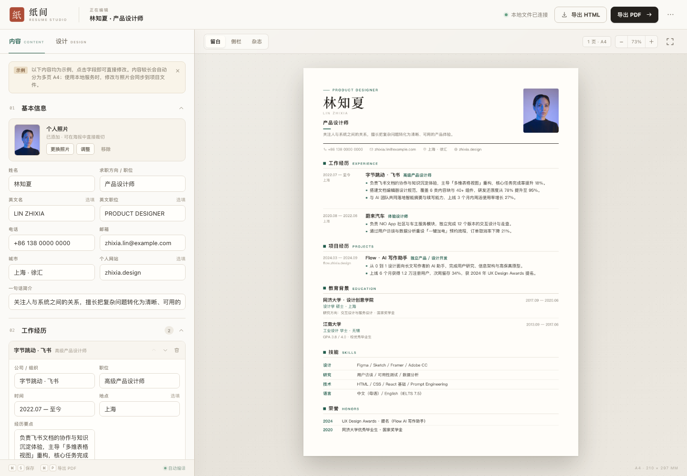
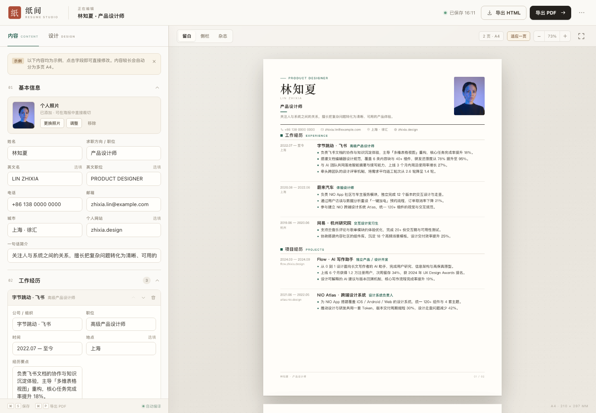

# 纸间 · Resume Studio

一个本地优先、无需安装依赖的中文简历工作台。左边改内容，右边实时编译成 A4 纸面，使用体验接近 Overleaf：所见即所得、自动保存，最后可导出独立 HTML 或 PDF。



## 直接查看

- 本地地址：<http://127.0.0.1:4173/>（如果服务未启动，见下方「启动」）
- 三套单页示例：
  - [留白 · PDF](exports/resume-minimal.pdf) / [HTML](exports/resume-minimal.html)
  - [侧栏 · PDF](exports/resume-sidebar.pdf) / [HTML](exports/resume-sidebar.html)
  - [杂志 · PDF](exports/resume-editorial.pdf) / [HTML](exports/resume-editorial.html)
- 两页长内容示例：[多页 PDF](exports/resume-multipage.pdf) / [HTML](exports/resume-multipage.html)（第 1 页：[预览](exports/previews/multipage-1.png)，第 2 页：[预览](exports/previews/multipage-2.png)）
- 预览图：[留白](exports/previews/minimal.png) · [侧栏](exports/previews/sidebar.png) · [杂志](exports/previews/editorial.png)

## 已实现

- **左编右预览**：姓名、简介、工作、项目、教育、技能、荣誉，全部是可直接修改的字段。
- **个人照片**：上传 JPG / PNG / WebP，自动压缩，支持水平 / 垂直位置与缩放裁切。
- **空值不占位**：英文名、英文职位、城市、地点、项目链接、补充信息等选填项未填时，直接从版式中移除，不显示默认占位文字；空白条目也不会出现在预览或 PDF 中。
- **三套 A4 模板**：留白（单栏）、侧栏（深色侧栏）、杂志（编辑感双栏）。
- **版式调节**：强调色、字体（无衬线 / 衬线 / 标题衬线）、字号、行距、页边距、双语栏目名。
- **实时编译与自动保存**：修改后立即刷新右页；约 0.4 秒后写入浏览器 `localStorage`，使用本地服务时同时写入项目内的 `data/resume.json`。
- **照片落盘**：使用本地服务时，上传照片会保存到 `assets/uploads/`，不再只存在于浏览器缓存里。
- **真多页排版**：内容超过一页时自动拆成多张 A4 页面，按经历/项目等条目边界断页；续页自动重复页眉、页码与模板样式，两页内容会自动做章节平衡。
- **长条目拆分**：单条经历或项目太长时，会按 bullet 自动拆分到续页，而不是粗暴裁切。
- **单页控制**：预览区右上角显示页数；确有需要时可点「适应一页」自动压缩字号与行距。
- **快速体验多页**：右上角「⋯」菜单 →「载入多页示例」，即可看到自动分成两页的效果。
- **导出 HTML**：生成一个完全独立的 HTML 文件，照片、样式全部内联，可直接打开、发送或归档。
- **导出 PDF**：调用浏览器打印引擎，输出矢量文字的高质量 A4 PDF。
- **JSON 备份**：导出 / 导入完整源数据，方便迁移或备份。
- **本地优先**：数据写入本机项目文件，不上传云端；只有同源的本地保存 API 请求。

## 多页行为

内容超过一页时，编辑器会自动进入真正的多页排版，而不是把一张长纸直接截断：



- 每页都是独立的 **210 × 297 mm** A4 页面，预览区可向下滚动查看。
- 分页优先发生在经历 / 项目 / 教育等条目边界；续页会重复页眉、页码与当前模板样式。
- 单条经历或项目过长时，会按 bullet 拆分到续页，而不是裁切。
- 两页内容会自动做章节平衡，避免出现「第一页塞满、第二页只有两行」。
- 「留白」续页使用紧凑页眉；「侧栏」续页使用紧凑侧栏；「杂志」续页使用编辑感单栏续页。
- 想快速查看效果：右上角 **⋯ → 载入多页示例**。

## 启动

使用项目自带的本地服务（静态页面 + 本地文件保存 API）：

```bash
./scripts/serve.sh 4173
# 浏览器打开 http://127.0.0.1:4173/
```

服务会在项目里写入：

```text
data/resume.json          # 简历数据
assets/uploads/           # 上传的照片
```

也可以直接双击 `index.html`，或部署到 GitHub Pages。此时没有本地 API，会自动退化为只用浏览器 `localStorage` 保存。

## 导出 PDF

在应用里点右上角 **导出 PDF**，浏览器会打开打印窗口：

1. 目标打印机选择 **存储为 PDF / Save as PDF**
2. 纸张选择 **A4**
3. 边距选择 **无 / None**
4. 建议勾选 **背景图形 / Background graphics**（侧栏底色需要）
5. 保存

应用已经通过 `@page` 与打印样式把页面固定为 A4，正常情况下边距与分页无需手动调整。

如果希望用命令行把已经导出的 HTML 转成 PDF：

```bash
./scripts/html-to-pdf.sh exports/resume-minimal.html exports/my-resume.pdf
```

脚本在 macOS 上默认使用 Google Chrome；其他平台可通过 `CHROME_BIN` 指定 Chrome / Chromium 路径。

## 快捷键

| 快捷键 | 功能 |
| --- | --- |
| `⌘ / Ctrl + S` | 立即保存到本地 |
| `⌘ / Ctrl + P` | 打开浏览器打印 / PDF |
| `Esc` | 关闭菜单或确认弹窗 |

## 项目结构

```text
.
├── index.html                  # 应用外壳 + 简历排版 CSS
├── assets/
│   ├── app.css                 # 编辑器 / 预览工作台样式
│   ├── app.js                  # 数据、渲染、交互、导入导出、本地同步
│   ├── sample-photo.js         # 内联的示例照片（base64）
│   ├── portrait.jpg            # 示例照片源文件
│   ├── uploads/                # 本地上传照片（gitignore）
│   └── favicon.svg
├── data/
│   ├── .gitkeep
│   └── resume.json             # 本地保存的简历（gitignore）
├── exports/
│   ├── resume-*.html           # 单页 / 多页独立示例
│   ├── resume-*.pdf            # 单页 / 多页 A4 成品
│   └── previews/               # 界面与成品预览图
└── scripts/
    ├── serve.sh                # 本地服务入口
    ├── local_server.py         # 静态文件 + 本地 JSON/照片保存 API
    └── html-to-pdf.sh          # HTML → PDF（Chrome headless）
```

## 数据与照片

使用 `./scripts/serve.sh` 启动时：

- 简历数据自动保存到 `data/resume.json`。
- 上传照片自动压缩为最长边 1000px 的 JPEG，保存到 `assets/uploads/`。
- `data/resume.json` 里的照片字段是相对路径，重新打开页面时会从本地图片文件加载。
- 页面顶部的保存状态会显示「已同步 HH:MM」；本地服务不可用时退化为「已保存 HH:MM」。
- 导出 HTML 时，本地照片会自动转回 data URL 内联，导出的单文件仍然可以独立打开。
- `data/` 和 `assets/uploads/` 已加入 `.gitignore`，避免个人简历和照片被误提交到公开仓库。

如果不使用本地服务（直接打开 HTML 或部署到 GitHub Pages）：

- 只使用浏览器 `localStorage`，键名为 `papercv.studio.v1`。
- 换浏览器、换域名或清除站点数据后，内容不会自动迁移。
- 重要内容建议用右上角「⋯ → 导出 JSON」备份。

示例人物照片来自 Unsplash（Unsplash License），仅用于演示版式。正式使用时请替换为自己的照片；示例姓名、公司、经历、联系方式均为虚构内容。

## 说明与边界

- PDF 由浏览器打印引擎生成，因此文本可选中、可检索，不依赖截图，清晰度不受屏幕缩放影响。
- 自动分页按章节 / 条目边界进行；不提供手动插入分页符。极长的单条内容会继续按 bullet 拆分。
- 侧栏 / 杂志模板的侧栏信息固定出现在第一页，不参与主内容分页。如果技能、教育或荣誉本身就超过一页，建议改用「留白」模板，或精简侧栏内容。
- 单页示例的「适应一页」会重新压缩字号与行距；内容确实太多时会提示精简，而不是无限缩小。
- 本地文件同步要求通过 `./scripts/serve.sh` 启动；普通静态服务器或 GitHub Pages 没有保存 API，会使用 `localStorage`。
- 若浏览器禁用了 `localStorage` 且本地 API 不可用，内容仍可编辑和导出，但刷新后不会保留。

## 示例照片

Demo portrait: Unsplash, photo ID `photo-1534528741775-53994a69daeb`, used under the [Unsplash License](https://unsplash.com/license).

## License

代码以 [MIT License](LICENSE) 发布。示例照片来自 Unsplash，遵循其单独的 [Unsplash License](https://unsplash.com/license)，正式使用时请替换为自己的照片。
